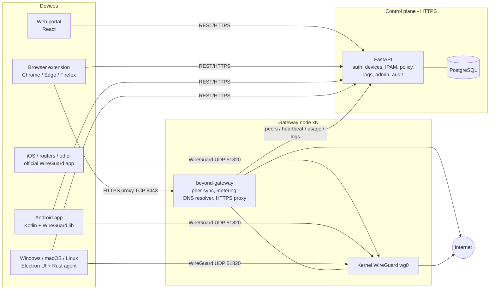

# Beyond VPN — Architecture

## 1. Context



## 2. Trust boundaries

| Boundary | Authentication | Data crossing |
|---|---|---|
| Client → control plane | Password + optional TOTP → EdDSA access JWT (15 min) + rotating refresh token | Public keys, posture, settings |
| Client → gateway (WireGuard) | Curve25519 static keys + per-peer PSK | All tunnelled traffic |
| Extension → gateway proxy | TLS + EdDSA proxy token (`aud` = gateway, 30 min) | Browser traffic |
| Gateway → control plane | `X-Gateway-Id` + 256-bit secret (SHA-256 at rest) over HTTPS | Usage, DNS/web logs, heartbeat; receives peers + PSKs + policy |
| UI → desktop agent | Loopback, 256-bit token, no `Origin`, Host allow-list | Commands |

The control plane never holds client private keys. Gateways can verify but not mint tokens. A compromised gateway can see traffic that traverses it (inherent to any VPN) but cannot impersonate users elsewhere or attribute logs to users who are not its peers.

## 3. Connection flow (desktop / Android)

```mermaid
sequenceDiagram
  participant D as Device (agent/app)
  participant C as Control plane
  participant G as Gateway
  D->>D: generate Curve25519 keypair (first run)
  D->>C: POST /auth/login (email, password, TOTP)
  C-->>D: access JWT + refresh token
  D->>C: POST /devices (public key, posture)
  D->>C: GET /servers  → probe RTT, pick fastest
  D->>C: POST /sessions/connect (device, server)
  C->>C: posture + data-cap + policy checks, allocate tunnel IP, PSK
  C-->>D: address, DNS=10.8.0.1, gateway pubkey, PSK, endpoint
  G->>C: GET /gateway/peers (every 10 s)
  C-->>G: peer list (+ signing key, blocklist, logging mode)
  G->>G: wg set peer … allowed-ips 10.8.0.x/32
  D->>G: WireGuard handshake; all traffic + DNS through tunnel
  G->>C: POST usage / dns-logs (every 15–30 s)
```

## 4. Browser extension flow

1. Popup sign-in → refresh token in `storage.local`, access token in `storage.session`.
2. Connect → `POST /proxy/token {server_id}` → `{host, port, token, expires_at}`.
3. `chrome.proxy.settings` = HTTPS proxy `host:8443`, bypass list (LAN, control plane, user domains); no DIRECT fallback.
4. Gateway answers `407`; `webRequest.onAuthRequired` supplies `beyond:<token>`.
5. Rust proxy verifies EdDSA token (`typ=proxy`, `aud=gateway`), checks blocklist + SSRF guard, tunnels, logs host/bytes.
6. Alarm refreshes the token 5 minutes before expiry.

## 5. Logging pipeline

| Source | What | Granularity | Mode needed |
|---|---|---|---|
| WireGuard counters | Bytes up/down per device | 30 s deltas → `usage_daily` + session | always (metering) |
| Gateway DNS resolver | Domain, query type, blocked flag, device | per query | `full` |
| Gateway HTTPS proxy | Host, port, bytes, duration, blocked flag | per connection | `full` (host) / `metadata` (bytes only) |
| Control plane | Logins, connects, admin actions, log views/exports | per event | always (audit, hash-chained) |

Retention purge runs every 6 h (`BEYOND_LOG_RETENTION_DAYS`).

## 6. Feature comparison

| Feature | FortiClient VPN | Proton VPN | **Beyond VPN v0.2** |
|---|---|---|---|
| Protocol | SSL-VPN / IPsec | WireGuard, OpenVPN, Stealth | WireGuard (+ HTTPS proxy for browsers) |
| Platforms | Win/mac/Linux/iOS/Android | Win/mac/Linux/iOS/Android/TV/browser | Win/mac/Linux (agent), Android (native), iOS & routers (WG app), browsers (extension), web portal |
| Kill switch | ✔ | ✔ (+ permanent) | ✔ default ON (desktop), WFP/nftables, Android Always-on link, extension fail-closed |
| Split tunnelling | ✔ (routes) | ✔ (apps, IPs) | ✔ routes + allow-LAN (desktop), per-app (Android), domains (extension) |
| Ad/malware blocking | via FortiGuard | NetShield | ✔ gateway DNS blocklist + admin policy |
| MFA | ✔ (FortiToken) | ✔ | ✔ TOTP |
| SSO | ✔ SAML | — (business) | ⏳ P1 |
| Device posture / ZTNA | ✔ (EMS) | — | ✔ basic (OS, firewall, root) — extended P1 |
| Central admin, logs, reports | ✔ (EMS/FortiAnalyzer) | business dashboard | ✔ portal admin, DNS/web logs, CSV, reports, audit chain |
| Data caps / quotas | — | free tier limits | ✔ per-user monthly cap |
| Fastest server / load | ✔ (best gateway) | ✔ quick connect | ✔ RTT × load |
| WebRTC leak protection | — | ✔ (extension) | ✔ |
| Secure Core / multi-hop | — | ✔ | ⏳ P1 |
| Stealth / obfuscation | — | ✔ | ⏳ P1 |
| User transparency of own logs | — | (no logs) | ✔ |

## 7. Scaling model

- **Gateways** scale horizontally; each is independent and keeps working with the last peer list if the control plane is unreachable (new connects wait). Capacity per node is configurable; load is reported and used for server choice.
- **Control plane** is stateless except DB → run N replicas behind Caddy/LB; move rate limiting to Redis (THINGS_REMAINING #7).
- **Logs**: at high volume, partition `dns_logs`/`proxy_logs` by day (PostgreSQL native partitioning) or ship to ClickHouse/OpenSearch; the API layer is unchanged.

Rough sizing: 10 k concurrent users ≈ 40 gateways × 250 peers (2 vCPU each) + 2 control-plane replicas (2 vCPU) + PostgreSQL (4 vCPU, 16 GB). DNS logs ≈ 2–5 k queries/user/day ≈ 50 M rows/day at 10 k users → partitioning required beyond a few thousand users.
